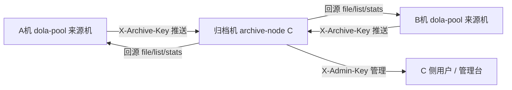

# C 机职责说明书（归档机 / archive-node）

> 本文档定义 C 机的身份、职责、协作方式、红线与部署方法，供 A 机、B 机及后续接手方参考。
> 维护约定：本文件如有变更，按仓库台账规范先在 `交互记录.md` 登记，再提交。

## 0. 一句话

C 机是 **archive-node 归档机** 的部署与运维责任方：它为 A 机、B 机等 dola-pool 来源机提供独立的文件归档与回源服务，并通过 Git 台账与它们协同。

## 1. 我是谁（称呼与身份）

| 项目 | 内容 |
|------|------|
| 称呼 | **C（C 机）**，台账条目编号前缀 `C#` |
| 角色 | 归档机（archive-node）服务端部署方与运维方 |
| 运行环境 | 独立沙箱，工作目录 `当前工作区/archive-node` |
| 服务端口 | `0.0.0.0:8100`（FastAPI / uvicorn） |
| 对外入口 | 平台预览域名（示例 `https://8100-6050e879a6f9affc.monkeycode-ai.online`） |
| 代码仓库 | `https://github.com/changzhangpp/archive-node.git`（main 分支） |
| 管理凭据 | `admin_key`（存 `config.json`，不入库） |

角色对照：**A** = A 机（dola-pool 来源机，面板 8004）；**B** = B 机（同型来源机）。来源机负责生成视频/图片等产物并推送给归档机归档，归档机负责存储、校验、回源。

## 2. 我要做什么（职责范围）

1. **部署与运行归档服务**：运行 `server.py`，维护 `/health` 可用性；版本升级走零停机交接。
2. **来源机注册与管理**：在 `config.json` / 管理台维护 `sources`（名称、key、quota_mb），登记谁可以归档。
3. **归档链路保障**：sha256 + size 双校验、重复推送幂等、按来源机配额限流（超限 507）、支持分片上传大文件与回源拉取。
4. **文件管理**：按来源机浏览（分页）、下载、删除单个、清空某来源机；删除操作带确认与审计。
5. **操作审计**：写操作按来源（来源机 key / admin）留痕入 `audit_log`，默认保留 30 天；提供查询页、筛选、CSV 导出。
6. **可用性监控**：`monitor.sh` 双探针（本机 8100 + 外网预览域名）每 30 秒探测，状态变化与小时心跳记 `monitor.log`。
7. **台账协作**：维护 `交互记录.md`，与 A/B 对账、登记、回执、收口，确保多方状态同步。
8. **数据安全**：来源隔离、密钥隔离、密钥不入库、不外泄。

## 3. 与 A 机 / B 机的交互方式

### 3.1 数据面（来源机 → 归档机）

来源机用 `X-Archive-Key` 请求头调用归档协议；归档机按 key 解析出登记名，全程以此判定归属。

| 端点 | 鉴权 | 说明 |
|------|------|------|
| `POST /archive/push?fname=&sha256=&size=[&mtime=&task_id=]` | X-Archive-Key | 直传归档，body 为文件原始字节 |
| `POST /archive/push_chunk` + `/archive/push_commit` | X-Archive-Key | 分片上传大文件（单请求体受预览代理 64KB 限制时使用） |
| `GET /archive/whoami` | X-Archive-Key | 按 key 返回登记名（挂载自检） |
| `GET /archive/file/{source}/{fname}` | X-Archive-Key | 回源拉取 |
| `GET /archive/list/{source}` / `GET /archive/stats` | X-Archive-Key | 清单 / 占用统计 |

**隔离规则**：来源机只能读写自己命名空间，跨源请求返回 403；`/archive/stats` 与 `/health` 全局可见。

### 3.2 管理面（C 侧）

C 用 `X-Admin-Key` 调管理接口，或在管理台（`/admin`）操作：资源管理、文件管理、来源机配置、操作日志。下载直链可用 `?key=` 查询参数。

### 3.3 协作面（Git 台账）

- 主台账：本仓库 `交互记录.md`（A#/B#/C# 编号）
- 副台账：dola-pool 侧 `AB交互记录.md`，两表通过编号互相引用
- **维护约定**：
  1. **先登记后处理**：任何变更/改造/问题，先追加一条记录，再动手。
  2. **发起方义务**：要素齐全（时间/方向/类型/事项/内容/状态），问题类附现象、根因、复现或验证方法、修复 commit。
  3. **接收方义务**：收到通报必须亲自复现与验证，再新增反向记录（类型「验证」），不得未验证就改状态。
  4. **开工前置检查**：动手前先通读台账，清偿遗留的「待办/验证中/处理中」条目。
  5. 一个变更一个 commit，提交信息带 `feat`/`fix`/`docs` 前缀。
- **格式硬性要求**：每行 8 个竖线（与表头对齐）；单元格内禁用裸竖线；状态变更需在内容列补「状态变更说明」。

### 3.4 挂载 / 对接流程

1. C 在管理台「来源机关联配置」登记来源机（名称 / key / 配额）。
2. C 把归档机**对外访问地址 + 该来源机的 key** 发给 A 或 B。
3. A/B 在 dola-pool 面板「归档节点」填入地址 + key，测试联通后启用。
4. 双方用 `/archive/whoami`、`/health` 核对登记名与来源机列表。



## 4. 注意事项与红线

1. **非必要不删除文件**：中转件完成使命后默认保留；批量清理须先列清单、经来源方在台账确认；C 代操作一律从严。用户手动删除不受限。
2. **sources / config 变更增量合并**：写 `sources` 必须先 GET 现网全量、增量合并，禁止整表盲替（历史事故教训）。
3. **来源隔离**：来源机只能访问自己命名空间，跨源必须 403。
4. **配额语义**：`quota_mb = 0` 表示不限制（用满磁盘）。
5. **密钥管理**：`admin_key` 与来源机 key 只存 `config.json`（已 gitignore）；不在对话、日志、提交中展示真实值。
6. **Git 操作**：需绕过平台注入的 `GIT_CONFIG_*` 环境变量后用 `git` 命令；push 前先 `fetch` + `rebase`；仓库身份 `changzhangpp`。
7. **服务托管与升级**：服务用后台终端托管（不用 setsid/nohup 手工挂）；升级走零停机 SOP——先起新实例（自绑 SO_REUSEPORT socket，可并行绑 8100）→ `/health` 探活通过 → 再停旧实例，端口全程不离线。
8. **平台红线**：不安装保活规避休眠的工具、不搭隧道/代理、不安装第三方 Agent、不对外提供信息服务面板。
9. **台账格式**：每行 8 竖线、单元格禁裸竖线、状态更新补说明。

## 5. 如何部署我

### 5.1 前置

- 一个可联网的沙箱（工作目录 `当前工作区`），Python 3。
- 具备私有仓库访问权限的 GitHub PAT。
- 依赖：`fastapi`、`uvicorn`、`psutil`、`python-multipart`（见 `requirements.txt`）。

### 5.2 部署步骤

```bash
# 1. 拉取代码
git clone https://github.com/changzhangpp/archive-node.git
cd archive-node

# 2. 安装依赖（Debian 系需 --break-system-packages）
python3 -m pip install --break-system-packages -q -r requirements.txt

# 3. 首次启动（自动生成 config.json 并打印随机 admin_key）
python3 server.py

# 生产/常驻：用后台终端托管，不要用 setsid nohup
```

启动后：

```bash
# 4. 探活
curl -s http://127.0.0.1:8100/health

# 5. 打开管理台（外网用平台预览地址 + /admin），登录后登记来源机
#    http://127.0.0.1:8100/admin
```

### 5.3 首次配置

1. 记下启动日志里的 `admin_key`（或在 `config.json` 中查看/修改）。
2. 管理台「来源机关联配置」添加来源机：名称（如 A机）、key（如 `arch-xxx`）、配额（`0` = 不限）。
3. 把**对外预览地址 + 对应 key** 发给来源机方，对方在 dola-pool 面板挂载。
4. 双方用 `/archive/whoami` 验证登记名一致。

### 5.4 升级（零停机 SOP）

1. 新实例起在另一个后台终端（`python3 server.py`，自绑 REUSEPORT socket 可与旧实例并行绑 8100）。
2. `/health` 返回新版本且正常。
3. 停旧实例终端。全程端口不离线，外网无 521 空窗。

### 5.5 可选：可用性监控

```bash
# 后台终端托管运行
./monitor.sh
# 探测结果记 monitor.log：L=本机状态码 E=外网状态码，状态变化与小时心跳
```

### 5.6 运维速查

| 事项 | 位置 / 命令 |
|------|------------|
| 服务主程序 | `server.py`（8100） |
| 文件管理 / 资源监控 API | `tools_api.py`、`web/fm.html`、`web/mon.html` |
| 运行配置（密钥/来源机/保留期） | `config.json`（不入库） |
| 归档数据 / 清单 | `data/{来源机名}/`、`archive.db` |
| 台账 | `交互记录.md` |
| 监控日志 | `monitor.log` |

> 注：仓库根 `README.md` 的 clone 地址写的是 dola-poolmanage 分支，实际本仓库已独立为 `changzhangpp/archive-node`；以本文件与 `git remote -v` 为准。
